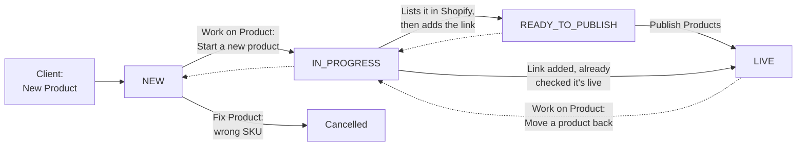
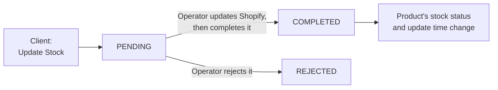

# Product operations

How a new piece gets from the client to a live Shopify product, and how stock
changes reach Shopify, using Apple Shortcuts, a shared iCloud folder, optional
Numbers exports and the operator's agent-assisted listing workflow.

These shortcuts keep the record of what's been submitted, what's being worked on,
and what's live or out of stock. They never change Shopify. Shopify is updated by the
operator, by hand or with the **add-products** skill. The skill now accepts one
pasted photo per SKU and completes images, listing, publication and logged
register updates through a controlled helper. This supersedes decision 24's
read-only/manual-handoff boundary; see [agent processing](agent-processing.md)
and [decision 37](../decisions.md#37-process-products-one-by-one-with-a-photo-handoff-and-logged-agent-updates).

## The shortcuts

Build 20 installs **Periwinkle - Client** and **Periwinkle - Operator**.
Each starts with four operation choices below. Only Client is shared with the
client; the operator can install both for testing. One operation runs per launch.
The generator keeps operations modular and inlines them into the two files,
so neither file depends on other installed shortcuts.
All three label entry points now print the selling price below the SKU. Reprints
use the current register price; costs never appear on the label. The client has
confirmed physical SKU-only printing on the B1; the new price layout needs a
print check after installing build 20.
[Role shortcuts](role-shortcuts.md) covers installation, updates and migration.
Each operation still has its own page and diagram.

| First-menu operation | Role | What it's for |
|---|---|---|
| [New Product](new-product.md) | Client | Submit a new piece with its photos |
| [Print Product Label](new-product.md#print-again-without-resubmitting) | Client | Prepare or reprint a submitted piece's SKU label in NIIMBOT |
| [Update Stock](update-stock.md) | Client | Report that a piece is out of stock or back in stock |
| [Fix Product](fix-product.md) | Client | Correct a price or cancel a wrong SKU, until work starts |
| [Work on Product](work-on-product.md) | Operator | Start a product, record its link, move it back, correct prices |
| [Publish Products](publish-products.md) | Operator | Mark a batch of ready products as LIVE |
| [Process Stock Requests](process-stock-requests.md) | Operator | Complete or reject the client's stock requests |
| [Register](register.md) | Operator | Browse/find products and optionally export tables to Numbers |

Also here:
- [Agent processing](agent-processing.md): invoke the skill, paste one requested
  SKU photo at a time, and review the finished live listings.
- [Rebuild and share a release](building-and-signing.md#build-all-workflows-from-scratch):
  reproduce both role bundles and stage the client's single account-bound file in iCloud.
- [Installation](installation.md): setting up a phone, and sharing with the client.
- [Recovery](recovery.md): recreate the entire folder structure, restore metadata,
  preserve SKU numbering and rebuild account references after deletion.
- [Mac photo export](mac-photo-export.md): verified Photos UI export, temporary
  working copies and the still-experimental command-line shortcut route.
- [Building and signing](building-and-signing.md): recreating or changing the
  shortcuts, and the iPhone behaviours they're written around.
- [Listing checklist](listing-checklist.md): what a Shopify listing needs.
- [Test report](test-report.md): what has been tested, and what hasn't.
- [Improvements](improvements.md): fixes and ideas to pick up later, on hold until the
  client's phone has been tested.

## How a product moves



Publication status and stock status are separate. A product can be `LIVE` and
`OUT_OF_STOCK` at once, and changing one never changes the other. A link alone
never makes a product `LIVE`: the operator has to confirm it.

## How a stock change moves



The client reports a status only, never a quantity. Every variant tracks its
quantity and stops selling at zero
([decision 16](../decisions.md#16-every-variant-tracks-stock-and-stops-selling-at-zero)),
so bringing a piece back in stock means entering a number in Shopify. Most
pieces are one of a kind, so that's usually 1.

## Daily routine

**Client** — open Periwinkle - Client, then choose the operation.
1. New piece: run New Product, pick the category, and tap through the suggested number.
   Then paste the caption and post to the album. Choose **Prepare SKU label** to
   open its PDF in NIIMBOT, tap **Add**, and print the label for the piece straight
   away ([decision 25](../decisions.md#25-the-client-prints-the-sku-label-right-after-submitting)).
   For a retry, use **Print Product Label**, without submitting the product again.
2. Sold or back: run Update Stock.
3. Typed something wrong: run Fix Product straight away. If work has started,
   message the operator.

**Operator** — use [agent processing](agent-processing.md) for the usual listing route.
1. Invoke **$add-products** in a fresh Codex session in this repo, or **/add-products**
   in Claude Code. The agent reads the queue and claims only the current SKU.
2. When it asks for that SKU's photo, open the existing Register/Work on Product
   preview and paste the image into chat. The agent prepares images, completes
   and publishes the listing, saves its link and records LIVE before asking for
   the next SKU. You do not manually paste Shopify links or mark publication.
3. Review the final product links and any blocked items. Printing/attaching labels
   remains manual for the client. Process Stock Requests remains a separate workflow.

For manual listing, the Operator menu still supports Work on Product → Start,
Add or fix a Shopify link and Publish Products. Do not use the manual and agent
writers concurrently on the same SKU. Status-only agent requests are read-only.

## Where the data lives

Everything is in one iCloud Drive folder, **Periwinkle Product Operations**,
created by hand at the top level of iCloud Drive. It can't go inside the
`Shortcuts` folder: that one belongs to the app and reportedly can't be shared.

```text
Periwinkle Product Operations/
  settings.json                     Valid statuses, currency, time zone
  sku-start.json                    Each category's starting number
  products/<sku>.json               What was submitted. Used to spot duplicates
  products/_cancelled/<time>/       Cancelled submissions
  register/<STATUS>/<sku>.json      A product's current row, in one status folder
  register/_replaced/<time>/        Every earlier version of a row
  register/_cancelled/<time>/       Rows of cancelled submissions
  stock-requests/PENDING/<id>.json  Waiting for the operator
  stock-requests/COMPLETED/<id>.json
  stock-requests/REJECTED/<id>.json
  stock-requests/_handled/<time>/   The original of each processed request
  log/<time>-<sku>-<event>.json     One file per event, never changed
  views/*.csv                       Tables for Numbers, rebuilt on demand
  photo-links/<sku>.json            Album/name/date reference only, no image bytes
  photo-pending/<sku>.json          Pending album-name snapshot, then completion marker
  agent/jobs/<sku>.json              Agent submission identity, stage and Shopify/media IDs
  agent/transactions/<uuid>.json     Recoverable before/after row and event intents
  agent/tmp/                        Atomic metadata staging only, no photo files
```

File names use the SKU in lowercase, which makes duplicate checks
case-insensitive and exact. The SKU as typed is kept inside the file, so
hyphens and leading zeros survive. Every folder holds a `_keep.txt`: please
leave those in place. [Installation](installation.md#initial-files) lists what the
folder needs before first use.

**Why one small file per event:** two phones editing one file can produce sync
conflicts and lost records. New files can't overwrite each other. The product records
that get overwritten are a product's row and, when the client corrects prices, its
submission. Photo links and pending snapshots are also updated during client
confirmation or recovery. Only one person edits those at a time: the client while it's `NEW`, the
operator after that.

**Storage:** records are a few hundred bytes each, so thousands take a few MB.
Photos stay in the Shared Album and never enter this folder.

### Record fields

| Table | Fields |
|---|---|
| Product row | `sku`, `costPrice`, `sellingPrice`, `productStatus`, `stockStatus`, `shopifyUrl`, `submittedAt`, `publishedAt`, `lastStockUpdateAt`, `operatorNotes` |
| Stock request | `requestId`, `sku`, `requestedStockStatus`, `requestStatus`, `requestedAt`, `processedAt`, `operatorNotes` |
| Activity log | `timestamp`, `sku`, `eventType`, `previousValue`, `newValue`, `source`, `notes` |
| Photo link | `version`, `sku`, `albumName`, `photoName`, `photoTakenAt`; intake also sets `source` |

Log event types: `PRODUCT_SUBMITTED`, `PRICE_CORRECTED`,
`SUBMISSION_CANCELLED`, `PROCESSING_STARTED`, `SHOPIFY_URL_RECORDED`,
`PRODUCT_PUBLISHED`, `STATUS_MOVED_BACK`, `STOCK_REQUESTED`,
`STOCK_REQUEST_COMPLETED`, `STOCK_REQUEST_REJECTED`.

## SKUs

- The format and codes are in [sku-codes.md](../sku-codes.md): `PBS-<CODE>-<NNN>`.
- The client picks a category and a number, and the shortcut builds the SKU. New
  Product [suggests the next number](new-product.md#how-the-number-is-chosen). This
  replaces the client's notebook.
- **Before using a category that has older products,** set its starting number. See
  [Installation](installation.md#initial-files). Otherwise the register starts at `001`,
  which may match an SKU already in Shopify.
- Operator manual lookup also uses category plus number. Retired SKU formats
  are not offered during this catalogue rebuild.
- Duplicates are only checked against this register, not against SKUs already
  in Shopify. If an old product is still active with the same SKU, Shopify
  won't warn you here.

## Known limits

- **Numbers is a snapshot.** Each table is rebuilt when Register runs. Typing
  into it changes nothing and is lost on the next refresh. Shortcuts can only
  add rows to Numbers, not read or update them, so a live workbook can't do
  duplicate checks or status changes.
- **SKU-comment search is not used.** Build 13 can preview a manually linked
  photo from its Shared Album by name/date. New Product (included in build 19) confirms the
  posted reference during intake; cross-account matching still needs testing. For an unlinked photo, use the register's
  submitted date to find photos. See [Next phase](#next-phase).
- **Posting isn't confirmed.** The record is saved before the Share sheet opens,
  because Shortcuts can't tell whether the client posted. If the client cancels,
  the product stays `NEW` with no photos in the album.
- **Captions don't update.** Shortcuts can't edit an album comment, so the
  register is the source of truth for prices and links.
- **Sync isn't instant.** A record reaches the other phone once iCloud syncs,
  usually in seconds. Offline, a duplicate check only sees what's on that phone.
- **Time zone.** Times use the phone's own zone. They're right for Asia/Kolkata
  while both phones are set to India, and the offset is stored with each time.
- **Speed.** Reading records takes about 0.2 seconds each, so Register took
  about 2 minutes for 500. Lookups also list each folder they check, about 5
  seconds per 500 files, so Update Stock will slow down as the catalogue grows.
- **No automatic rollback.** Shortcuts can't catch errors, so a stopped run can't
  undo itself. Flows save the new record and log first, and move the old file
  last, so a failure leaves at worst a spare copy. Fix a wrong status with
  [Move a product back](work-on-product.md).

## Next phase

- **Photo lookup by SKU:** a Shared Library was tested and ruled out
  ([decision 26](../decisions.md#26-stay-with-the-shared-album-not-a-shared-library)), so the
  album stays. See [Finding photos](improvements.md#finding-photos) for what else could help.
- **Existing products:** they aren't in the register, so Update Stock doesn't
  know them. The idea of archiving them and recreating them through this system
  is still undecided.
