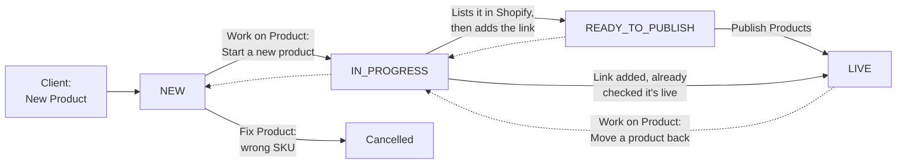
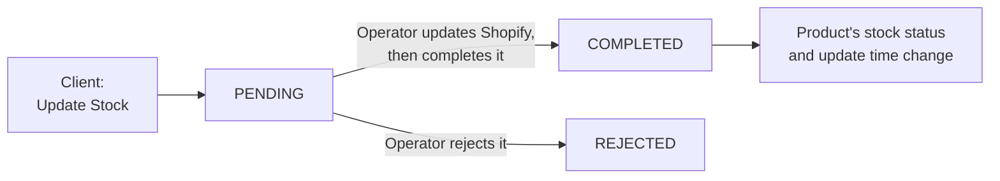

# Product operations

How a new piece gets from the client to a live Shopify product, and how stock
changes reach Shopify, using only Apple Shortcuts on two iPhones, a shared
iCloud folder and Numbers. There is no server, database or paid app.

Shopify is updated by hand. These shortcuts keep the record of what's been
submitted, what's being worked on, and what's live or out of stock. They never
change Shopify.

## The shortcuts

Each one has its own page, with a diagram of what it does.

| Shortcut | Who | What it's for |
|---|---|---|
| [New Product](new-product.md) | Client | Submit a new piece with its photos |
| [Update Stock](update-stock.md) | Client | Report that a piece is out of stock or back in stock |
| [Fix Product](fix-product.md) | Client | Correct a price or cancel a wrong SKU, until work starts |
| [Work on Product](work-on-product.md) | Operator | Start a product, record its link, move it back, correct prices |
| [Publish Products](publish-products.md) | Operator | Mark a batch of ready products as LIVE |
| [Process Stock Requests](process-stock-requests.md) | Operator | Complete or reject the client's stock requests |
| [Register](register.md) | Operator | Build the tables you read in Numbers |

Also here:
- [Installation](installation.md): setting up a phone, and sharing with the client.
- [Building and signing](building-and-signing.md): recreating or changing the
  shortcuts, and the iPhone behaviours they're written around.
- [Listing checklist](listing-checklist.md): what a Shopify listing needs.
- [Test report](test-report.md): what has been tested, and what hasn't.

## How a product moves



Publication status and stock status are separate. A product can be `LIVE` and
`OUT_OF_STOCK` at once, and changing one never changes the other. A link alone
never makes a product `LIVE`: the operator has to confirm it.

## How a stock change moves



The client reports a status only, never a quantity. Every variant tracks its
quantity and stops selling at zero
([decision 16](../decisions.md#16-every-variant-tracks-stock-and-stops-selling-at-zero)),
so bringing a piece back in stock means entering a number in Shopify. Most
pieces are one of a kind, so that's usually 1.

## Daily routine

**Client**
1. New piece: run New Product, then paste the caption and post to the album.
2. Sold or back: run Update Stock.
3. Typed something wrong: run Fix Product straight away. If work has started,
   message the operator.

**Operator**
1. Run Register → Products to see what's waiting.
2. Run Work on Product → Start a new product. The details are copied, ready
   for Claude.
3. Find the photos in the album using the submitted date, list the piece in
   Shopify with Claude, following the [listing checklist](listing-checklist.md).
4. Run Work on Product → Add or fix a Shopify link.
5. Run Publish Products once the products are live.
6. Run Process Stock Requests.

## Where the data lives

Everything is in one iCloud Drive folder, **Periwinkle Product Operations**,
created by hand at the top level of iCloud Drive. It can't go inside the
`Shortcuts` folder: that one belongs to the app and reportedly can't be shared.

```text
Periwinkle Product Operations/
  settings.json                     Valid statuses, currency, time zone
  products/<sku>.json               What was submitted. Used to spot duplicates
  products/_cancelled/<time>/       Cancelled submissions
  register/<STATUS>/<sku>.json      A product's current row, in one status folder
  register/_replaced/<time>/        Every earlier version of a row
  register/_cancelled/<time>/       Rows of cancelled submissions
  stock-requests/PENDING/<id>.json  Waiting for the operator
  stock-requests/COMPLETED/<id>.json
  stock-requests/REJECTED/<id>.json
  stock-requests/_handled/<time>/   The original of each processed request
  log/<time>-<sku>-<event>.json     One file per event, never changed
  views/*.csv                       Tables for Numbers, rebuilt on demand
```

File names use the SKU in lowercase, which makes duplicate checks
case-insensitive and exact. The SKU as typed is kept inside the file, so
hyphens and leading zeros survive. Every folder holds a `_keep.txt`: please
leave those in place. [Installation](installation.md#initial-files) lists what the
folder needs before first use.

**Why one small file per event:** two phones editing one file can produce sync
conflicts and lost records. New files can't overwrite each other. The only records
that get overwritten are a product's row and, when the client corrects prices, its
submission. Only one person edits those at a time: the client while it's `NEW`, the
operator after that.

**Storage:** records are a few hundred bytes each, so thousands take a few MB.
Photos stay in the Shared Album and never enter this folder.

### Record fields

| Table | Fields |
|---|---|
| Product row | `sku`, `costPrice`, `sellingPrice`, `productStatus`, `stockStatus`, `shopifyUrl`, `submittedAt`, `publishedAt`, `lastStockUpdateAt`, `operatorNotes` |
| Stock request | `requestId`, `sku`, `requestedStockStatus`, `requestStatus`, `requestedAt`, `processedAt`, `operatorNotes` |
| Activity log | `timestamp`, `sku`, `eventType`, `previousValue`, `newValue`, `source`, `notes` |

Log event types: `PRODUCT_SUBMITTED`, `PRICE_CORRECTED`,
`SUBMISSION_CANCELLED`, `PROCESSING_STARTED`, `SHOPIFY_URL_RECORDED`,
`PRODUCT_PUBLISHED`, `STATUS_MOVED_BACK`, `STOCK_REQUESTED`,
`STOCK_REQUEST_COMPLETED`, `STOCK_REQUEST_REJECTED`.

## SKUs

- The format is in [sku-codes.md](../sku-codes.md): `PBS-<CODE>-<NNN>`.
- The shortcuts accept letters, numbers, hyphens, dots and underscores, and
  must start with a letter or number. A slash would break the file path, so
  old SKUs like `PBS/SAR/069` are rejected.
- Duplicates are only checked against this register, not against SKUs already
  in Shopify. If an old product is still active with the same SKU, Shopify
  won't warn you here.

## Known limits

- **Numbers is a snapshot.** Each table is rebuilt when Register runs. Typing
  into it changes nothing and is lost on the next refresh. Shortcuts can only
  add rows to Numbers, not read or update them, so a live workbook can't do
  duplicate checks or status changes.
- **Photo search doesn't work.** Searching Photos for an SKU doesn't find the
  album photo, because the caption is stored as a comment. Use the register's
  submitted date to find photos. See [Next phase](#next-phase).
- **Posting isn't confirmed.** The record is saved before the Share sheet opens,
  because Shortcuts can't tell whether the client posted. If the client cancels,
  the product stays `NEW` with no photos in the album.
- **Captions don't update.** Shortcuts can't edit an album comment, so the
  register is the source of truth for prices and links.
- **Sync isn't instant.** A record reaches the other phone once iCloud syncs,
  usually in seconds. Offline, a duplicate check only sees what's on that phone.
- **Time zone.** Times use the phone's own zone. They're right for Asia/Kolkata
  while both phones are set to India, and the offset is stored with each time.
- **Speed.** Reading records takes about 0.2 seconds each, so Register took
  about 2 minutes for 500. Lookups also list each folder they check, about 5
  seconds per 500 files, so Update Stock will slow down as the catalogue grows.
- **No automatic rollback.** Shortcuts can't catch errors, so a stopped run can't
  undo itself. Flows save the new record and log first, and move the old file
  last, so a failure leaves at worst a spare copy. Fix a wrong status with
  [Move a product back](work-on-product.md).

## Next phase

- **Photo lookup by SKU:** consider moving from the Shared Album to an iCloud
  Shared Photo Library. Nothing has been tested yet, including whether captions
  there can be searched, so test it before planning around it.
- **Existing products:** they aren't in the register, so Update Stock doesn't
  know them. The idea of archiving them and recreating them through this system
  is still undecided.
