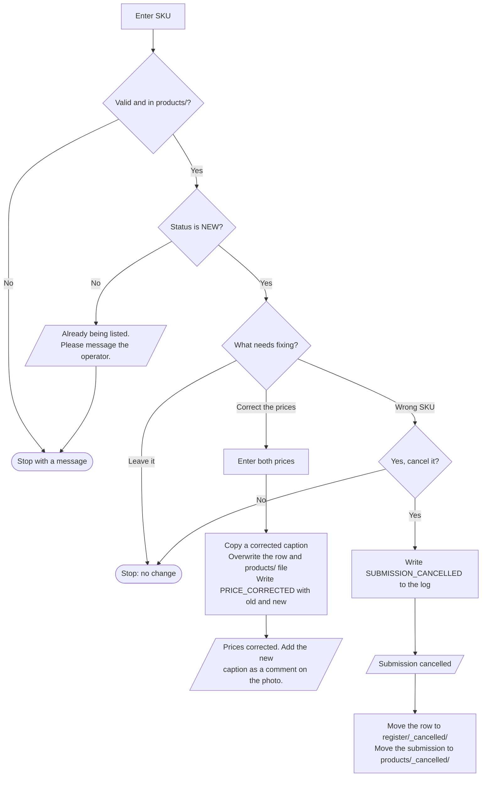

# Periwinkle – Fix Product

**Who runs it:** the client. **Source:** `fix_product` in
[`build.py`](../../product-ops/build/build.py).

Lets the client correct a mistake while a product is still `NEW`. After that,
work has started, so corrections go through the operator.

## What happens

## Rules

- Cancelling frees the SKU, so the right one can be submitted, and the wrong
  one can be used again later.
- Nothing is deleted. The cancelled files and the log keep the history.
- Photos already in the album stay there until the client deletes them. A
  shortcut can't do that.
- The album caption can't be edited by a shortcut, so the register is correct
  even if the old comment is still showing.

## After work has started

The operator handles it:
- A wrong price: [Work on Product](work-on-product.md) → Correct a product's prices.
- A wrong SKU: Move a product back to `NEW`, and the client can then cancel it here.
