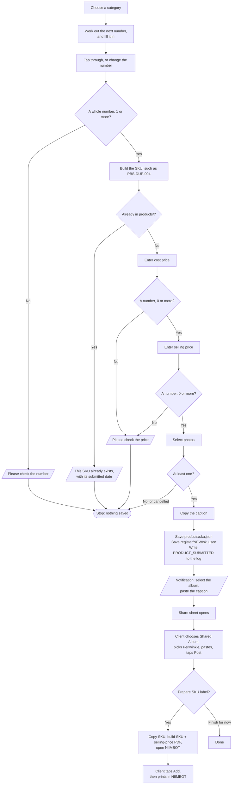

# Periwinkle – New Product

**Who runs it:** the client. **Source:** `new_product` in
[`build.py`](../../product-ops/build/build.py).

Records a new piece, copies a caption, and opens the Share sheet so the client
can post the photos to the Shared Album. The client picks a category and usually just
taps through the suggested number. After sharing, **Prepare SKU label** builds a
PDF with the SKU and selling price below it and opens NIIMBOT; **Finish for now** keeps the album caption on the
clipboard and ends the shortcut.

## What happens



## Caption

```text
SKU: PBS-DUP-001
COST PRICE: ₹1200
SELLING PRICE: ₹2800
STATUS: NEW
SUBMITTED VIA PERIWINKLE PRODUCT INTAKE
```

Paste this caption into the album **before** choosing Prepare SKU label. The
label handoff then replaces the clipboard with the SKU alone. Printing never
includes cost price or product status. Build 20 adds the selling price below the
SKU, for example:

```text
PBS-SAR-001
Rs. 3500
```

The ASCII `Rs.` currency prefix avoids the missing rupee glyph in the standard
PDF font. A positive price with up to two decimal places is required; unsupported
values stop label preparation rather than changing the price. The clipboard still
contains only the SKU.

## Print again without resubmitting

Run **Periwinkle - Client → Print Product Label**, choose the category and number,
and it reads the current register row before opening its label in NIIMBOT. It
uses that row's current selling price, including price corrections, rather than
the original submission price. **Operator → Register → product → Prepare SKU
label** uses the same generator and current price. Neither reprint path changes
product, stock or log records. Replace the physical label after a price change.
Use this after an interrupted print or to replace a damaged label; do not run
New Product again just to get another label.

The label is currently 50 × 30 mm. Confirm the client's actual roll dimensions
before physical printing. NIIMBOT's Crop and split → **Add** and **Print** steps
remain manual. On 22 November the client confirmed the previous SKU-only label
physically printed on the B1. The build-20 two-line price layout needs its own
phone import/print check using an existing product, without another submission.

## How the number is chosen

The shortcut takes the highest of these, and adds 1:
- the numbers already used in that category, from the file names in `products/`;
- that category's starting number in `sku-start.json`.

There's no separate counter that could drift from the records. So:
- Categories count separately.
- Cancelling the latest submission frees its number, so it's suggested again.
- Numbers pad to at least three digits and then keep growing: `004`, `999`, `1000`.
- If the client changes a number to `010`, the next suggestion is `011`. A skipped
  number isn't suggested later.
- Typing `4` gives `004`, so it can't get past the duplicate check as a different SKU.

## Rules

- Duplicates are checked exactly, on the finished SKU, with no partial matches.
- The price screens show the finished SKU, so the client can see it before continuing.
- Selling price doesn't have to be above cost.
- Nothing is saved until photos are chosen.

## Why it's built this way

- **The full keyboard, not the number keypad, on the number screen.** iPhone's keypad
  doesn't show a filled-in value.
- **Share, not "Post to Shared Album".** The Post action's only field is the photo. It posts
  to the last-used Shared Album, so the album can't be chosen and no comment can be set. The
  normal Share action lets the client choose both, by hand.
- **The notification comes before the Share sheet.** Afterwards would be too late
  to help.
- **The record is saved before sharing,** because a shortcut can't tell if the
  photos were posted. A cancelled Share sheet leaves the product `NEW`. Run
  [Fix Product](fix-product.md) to cancel it, or post the photos later.

## What to expect

Working out the number and checking for duplicates both read `products/`, so they
slow slightly as that folder grows. A permission prompt may appear on the first run: tap **Always Allow**.

## NIIMBOT printing experiment — 18 November 2026

The label printer is a **NIIMBOT B1**, held by the client in Bangalore. NIIMBOT is
installed on the operator's iPhone, but the operator does not have the printer.
Operator tests establish app launch/input handoff only; actual printing must be
tested separately on the client's phone with her printer.
Build 10 adds the optional label handoff to New Product and the standalone
Print Product Label shortcut. The operator's New Product was backed up and
replaced on the Mac; the reprint shortcut was installed there too. The client
build 11 package is now staged with her folder reference under the shared
folder's `shortcuts/client-build-11/`; installation on her phone is not yet confirmed.

The experiment is generated by
[`printing_experiment.py`](../../product-ops/build/printing_experiment.py).
It only uses the synthetic SKU `PBS-TEST-PRINT`, and never reads or writes the
product register, stock, photos or prices. It copies only that SKU, locally on
the device. The image is a 50 × 30 mm example at 203 dpi, not a detected roll size.

| Option | What it tests | iPhone result |
|---|---|---|
| 1 · Copy SKU and open NIIMBOT | App launch with the SKU ready to paste | v3 opened NIIMBOT on the operator's iPhone; clipboard paste not yet checked |
| 2 · Share SKU text | Whether NIIMBOT accepts text from the Share sheet | Pending |
| 3 · Share label image | Whether NIIMBOT accepts a rendered PNG from the Share sheet | NIIMBOT was listed under More and opened, but no image appeared |
| 4 · Send image directly to NIIMBOT | Whether Open In can hand a PNG directly to the app | v1 opened Preview; v3 opened NIIMBOT without the image |
| 5 · Choose NIIMBOT on this iPhone | Native Ask Each Time picker, independent of automatic app lookup | Pending |

In v3, start with option 1 to test runtime app lookup, then option 4. If option 1
fails, use option 5 and choose NIIMBOT from the iPhone's app picker. Try option 3
if direct image import fails. If an image
arrives, check whether it is ready to print or still needs importing/editing.
App launch or a successful share is not proof that a label printed. Also check
Shortcuts → a new shortcut → Add Action → Apps on iPhone for NIIMBOT actions;
the Mac action search cannot determine what an iPhone-only app exposes.

Apple's public app lookup identified the iPhone app as `com.suofang.jcbqdy`,
App Store ID `1359104615`, version `6.7.0` on 18 November. No documented direct
print URL or Shortcuts action was established during this investigation.

Build using a Python installation with Pillow (the Codex bundled runtime has it):

```bash
python3 product-ops/build/printing_experiment.py product-ops/local/printing-test
shortcuts sign --mode anyone --input "product-ops/local/printing-test/New Product – Print Test v3.raw.shortcut" --output "product-ops/local/printing-test/New Product – Print Test v3.shortcut"
```

The signed v1 test was imported and verified in the Mac's All Shortcuts library,
and the operator confirmed iPhone sync by running option 4. It opened Preview
with the image rather than NIIMBOT. The Mac editor also showed no selected app:
v1 supplied legacy identifiers plus `WFApp`, but modern actions use
`WFSelectedApp`. Option 1 also failed to launch NIIMBOT. A v2 probe with a static
`WFSelectedApp` descriptor was rebound by the Mac to `com.apple.MRT`, because
NIIMBOT is not installed there. This was confirmed by inspecting an export from
the Mac app. Do not use v1 or v2 for further tests.

V3 passes a Text action containing the verified bundle ID into `WFSelectedApp`,
so app lookup happens at runtime on the iPhone. Its fifth option uses the exact
Ask Each Time encoding exported from Apple's app picker. V3 was signed,
imported and inspected on the Mac; the dynamic target survived import.
These results do not establish whether NIIMBOT accepts PNG input.
The operator confirmed that v3 option 1 opens NIIMBOT on iPhone. Option 4 also
opened NIIMBOT, but without the image: app launch works, image import has not
been demonstrated. Option 3 also showed NIIMBOT under More and opened it, but
no image appeared. Neither PNG route has demonstrated content import.
Clipboard paste, document handoff and actual printing
still need confirmation. Experimental
actions are deliberately outside the production `CLIENT` list and are not
added to `TESTED_ACTIONS` until they have run on iPhone.

The PDF route is now integrated **after** album sharing. Keep the full caption
on the clipboard until the client has pasted it into the album; only then copy
the SKU for the label. Never send the intake caption, which includes cost price,
to the printing app. Keep label printing retryable without submitting another
product.

### PDF import test

NIIMBOT's [official B1 page](https://www.niimbot.com/uk/hardware/detail/HPC250522074010000007)
advertises PDF file import. This establishes a format to test, not that a
Shortcuts handoff will import or print automatically.

**New Product – PDF Print Test** was built, signed and installed on the Mac on
18 November. It has two routes: **1 · Open PDF in NIIMBOT** and **2 · Share PDF
to NIIMBOT**. It uses the same runtime app lookup as v3 and only the synthetic
SKU. It never reads or writes product records. The PDF contains one vector-text
50 × 30 mm page; match the client's actual label roll before production use.
The page dimensions/text and shortcut wiring were checked, and the rendered
PDF was visually reviewed. The operator confirmed option 1 opens NIIMBOT's
Crop and split screen with the correct label, and that the label can be added.
The supplied screenshot verifies that import screen. Share PDF and physical
printing have not been tested.

Build with the Codex bundled Python (Pillow, ReportLab and pypdf are included):

```bash
python3 product-ops/build/printing_experiment.py product-ops/local/printing-test --format pdf
shortcuts sign --mode anyone --input "product-ops/local/printing-test/New Product – PDF Print Test.raw.shortcut" --output "product-ops/local/printing-test/New Product – PDF Print Test.shortcut"
```

Test option 1 first; if there is no document, try option 2 → More → NIIMBOT.
Record any requirement to select a printer/model separately from import success:
the operator does not have the B1, so a connection-dependent test needs the client.

### Dynamic SKU PDF generation (build 10)

[`label_printing.py`](../../product-ops/build/label_printing.py) generates the
actual SKU's PDF using only native Shortcuts actions on iPhone. Fixed-width
ASCII fields preserve the PDF stream lengths and cross-reference offsets.
The font scales with SKU length; unsupported strings fail visibly instead of
being truncated. No service or Mac is needed while the client runs it.

18 automated checks pass, including strict PDF parsing, text/page dimensions,
cross-reference offsets, numbers beyond 999, invalid input rejection, read-only
reprinting, and the ordering after album sharing. Sample rendered labels were
visually inspected. The new dynamic generation actions and complete intake
flow still need an iPhone run; the earlier successful import used a static PDF.

## Automatic photo reference

Build 17 records the **uploaded Shared Album asset**, rather than assuming the
selected library photo keeps its original name. In the phone test, IMG_0499
became a UUID-style name after posting, so build 15's original-name reference
could not find it.

1. Before Share, read the target album's existing photo names and save a small
   metadata snapshot in `photo-pending/<sku>.json` alongside a pending link.
2. The client posts the selected photo(s) to the album named in the notification.
3. After the existing finish/label choice, find names newly added to that album.
4. Show the newly posted photo for client confirmation. With several new photos,
   the client chooses the correct one first. The operator does not search comments.
5. Save the confirmed album asset's actual Name and Date Taken to
   `photo-links/<sku>.json` with source shared_album_confirmed. Replace the
   snapshot contents with a tiny completion marker.

If upload has not synced or the client finishes later, use **Fix Product → Finish
photo linking**. Complete this before creating another product in the same album.
Only a client-confirmed reference becomes eligible for automatic operator preview;
Register does not silently select an unconfirmed new album photo. This matters
when another person uploads during intake. No image bytes are saved in Drive.

Create these as Shared Albums, with both accounts invited to the same albums:

| Category | Exact album name |
|---|---|
| Saree | Periwinkle - Sarees |
| Salwar Kameez | Periwinkle - Salwar Kameez |
| Miniature | Periwinkle - Miniatures |
| Readymades | Periwinkle - Readymades |
| Dupatta | Periwinkle - Dupattas |
| Home Decor | Periwinkle - Home Decor |
| Jewellery | Periwinkle - Jewellery |

All seven mappings are in CATEGORY_ALBUMS in photo_links.py. A new unmapped
category prompts for an exact album name. Existing confirmed links retain their
own album names, including Miniatures Available. Album posting, caption paste,
photo confirmation, and NIIMBOT Add/Print remain client actions.

**Phone verification needed:** own-account intake/post/confirmation/preview,
then client-to-operator delivery. Use the operator-account files on the operator
phone and client-account files on the client phone. The pending/renamed-upload
protocol has generator regression coverage but is not yet confirmed on-device.
