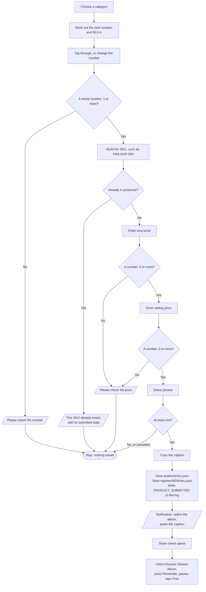

# Periwinkle – New Product

**Who runs it:** the client. **Source:** `new_product` in
[`build.py`](../../product-ops/build/build.py).

Records a new piece, copies a caption, and opens the Share sheet so the client
can post the photos to the Shared Album. The client picks a category and usually just
taps through the suggested number.

## What happens



## Caption

```text
SKU: PBS-DUP-001
COST PRICE: ₹1200
SELLING PRICE: ₹2800
STATUS: NEW
SUBMITTED VIA PERIWINKLE PRODUCT INTAKE
```

## How the number is chosen

The shortcut takes the highest of these, and adds 1:
- the numbers already used in that category, from the file names in `products/`;
- that category's starting number in `sku-start.json`.

There's no separate counter that could drift from the records. So:
- Categories count separately.
- Cancelling the latest submission frees its number, so it's suggested again.
- Numbers pad to at least three digits and then keep growing: `004`, `999`, `1000`.
- If the client changes a number to `010`, the next suggestion is `011`. A skipped
  number isn't suggested later.
- Typing `4` gives `004`, so it can't get past the duplicate check as a different SKU.

## Rules

- Duplicates are checked exactly, on the finished SKU, with no partial matches.
- The price screens show the finished SKU, so the client can see it before continuing.
- Selling price doesn't have to be above cost.
- Nothing is saved until photos are chosen.

## Why it's built this way

- **The full keyboard, not the number keypad, on the number screen.** iPhone's keypad
  doesn't show a filled-in value.
- **Share, not "Post to Shared Album".** On the client's iPhone, the Post action
  didn't open the expected screen, while the normal Share action does. The
  client has to choose the album, paste and post by hand.
- **The notification comes before the Share sheet.** Afterwards would be too late
  to help.
- **The record is saved before sharing,** because a shortcut can't tell if the
  photos were posted. A cancelled Share sheet leaves the product `NEW`. Run
  [Fix Product](fix-product.md) to cancel it, or post the photos later.

## What to expect

Working out the number and checking for duplicates both read `products/`, so they
slow slightly as that folder grows. A permission prompt may appear on the first run: tap **Always Allow**.
