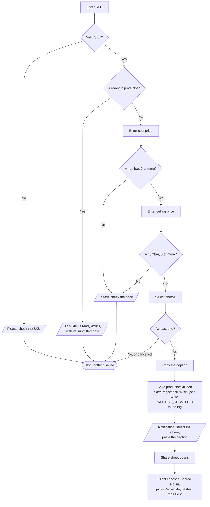

# Periwinkle – New Product

**Who runs it:** the client. **Source:** `new_product` in
[`build.py`](../../product-ops/build/build.py).

Records a new piece, copies a caption, and opens the Share sheet so the client
can post the photos to the Shared Album.

## What happens



## Caption

```text
SKU: PBS-DUP-001
COST PRICE: ₹1200
SELLING PRICE: ₹2800
STATUS: NEW
SUBMITTED VIA PERIWINKLE PRODUCT INTAKE
```

## Rules

- The SKU comparison is exact and ignores case, so `pbs-dup-001` counts as a
  duplicate of `PBS-DUP-001`, but `PBS-DUP-0011` doesn't.
- Selling price doesn't have to be above cost.
- Nothing is saved until photos are chosen.

## Why it's built this way

- **Share, not "Post to Shared Album".** On the client's iPhone, the Post action
  didn't open the expected screen, while the normal Share action does. The
  client has to choose the album, paste and post by hand.
- **The notification comes before the Share sheet.** Afterwards would be too late
  to help.
- **The record is saved before sharing,** because a shortcut can't tell if the
  photos were posted. A cancelled Share sheet leaves the product `NEW`. Run
  [Fix Product](fix-product.md) to cancel it, or post the photos later.

## What to expect

The SKU check looks through `products/`, so it slows slightly as that folder
grows. A permission prompt may appear on the first run: tap **Always Allow**.
