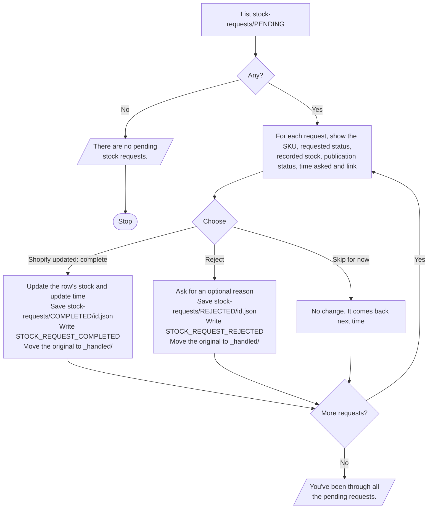

# Periwinkle – Process Stock Requests

**Who runs it:** the operator. **Source:** `process_stock_requests` in
[`build.py`](../../product-ops/build/build.py).

Goes through the client's pending stock requests one at a time. Update Shopify
yourself first, because this shortcut only records the result.

## What happens

## Rules

- Viewing a request doesn't complete it. Only tapping **complete** does.
- Publication status never changes here, so a `LIVE` product can be `OUT_OF_STOCK`.
- A rejected request leaves the product's stock unchanged.
- The original request is kept in `_handled/`, and its outcome stays in `COMPLETED`
  or `REJECTED`.

## Updating Shopify

- **Out of stock:** set the quantity to 0.
- **Back in stock:** enter the quantity. The client doesn't report one, and most
  pieces are one of a kind, so it's usually 1. Ask if unsure.
