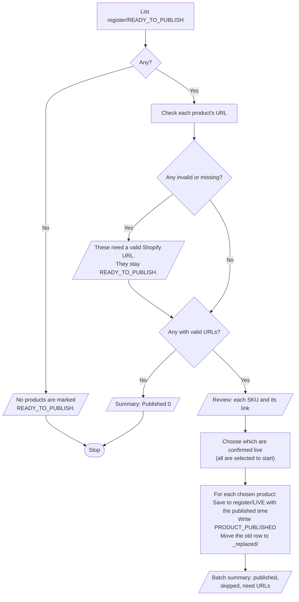

# Periwinkle – Publish Products

**Who runs it:** the operator. **Source:** `publish_products` in
[`build.py`](../../product-ops/build/build.py).

Marks a batch of `READY_TO_PUBLISH` products as `LIVE` in the register. It doesn't
publish anything in Shopify: do that first, then run this to record it.

## What happens

## Rules

- A product without a valid URL can't become `LIVE` here.
- Products you don't select stay `READY_TO_PUBLISH` and count as skipped.
- Stock status isn't touched.

If a product is already live when you add its link, use **I've checked it's live**
in [Work on Product](work-on-product.md) and skip this shortcut.
