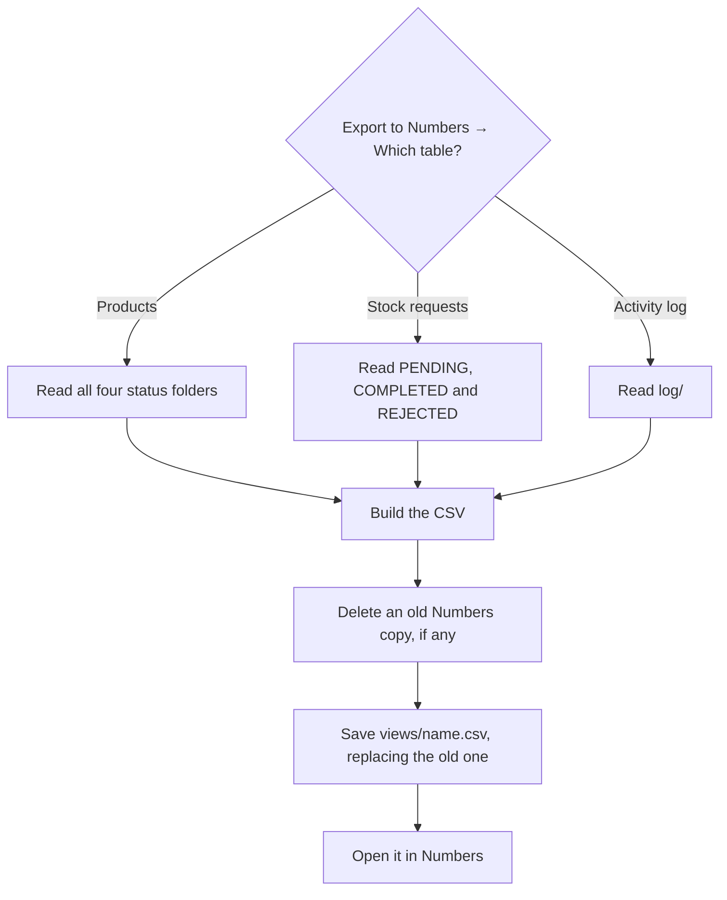

# Periwinkle – Register

**Who runs it:** the operator. **Source:** `register` in
[`build.py`](../../product-ops/build/build.py).

Build 20 includes the product browser introduced in build 12, with linked Shared Album previews. Browse by status and category, or find a
piece by category plus number. Inspect its prices, stock, dates, Shopify link and
notes without opening Numbers. CSV exports remain available separately.

## Browse and find products

- **Browse products:** choose a status (or All statuses), then a category (or All
  categories). Select a SKU from the list; each entry includes its status.
- **Find a product:** choose the category and enter only its number. For example,
  Dupatta + 4 finds `PBS-DUP-004`.
- **Details:** shows SKU, product/stock status, both prices, submission/publication/
  stock-update dates, Shopify link and notes. The submitted date helps locate
  unlinked photos in the Shared Album. A linked photo previews automatically before the details.
- **Product actions:** Copy SKU, Copy Shopify link, Prepare SKU label, Link or change photo, or Finish.
  Link copying stops with an explanation if no valid store link exists. NIIMBOT
  still requires Add and Print manually.

Build 20's Prepare SKU label prints the SKU and the current selling price below
it, using the same PDF generator as both Client label entry points. Cost is never
printed. Reprint and replace a physical label after a price correction.

Browsing lists filenames before reading the selected record, avoiding a full
JSON-to-CSV rebuild just to inspect one piece. It skips hidden files and conflict
copies, and shows each SKU once. If an interrupted transition left copies in
several status folders, the furthest status wins, matching `find_row()`. This
hides stale copies in the browser; it does not repair or archive them.

Browsing and finding never save, move or delete product, stock or activity
records. Use Work on Product, Update Stock and the other existing workflows to
make changes. Product menus do not launch these editing workflows automatically.

## Export to Numbers

Choose **Export to Numbers**, then Products, Stock requests or Activity log.
These exports keep the existing snapshot behaviour.

## What happens



## Files

| View | File | Columns |
|---|---|---|
| Products | `views/Product Register.csv` | SKU, CostPrice, SellingPrice, ProductStatus, StockStatus, ShopifyURL, SubmittedAt, PublishedAt, LastStockUpdateAt, OperatorNotes |
| Stock requests | `views/Stock Requests.csv` | SKU, RequestID, RequestedStockStatus, RequestStatus, RequestedAt, ProcessedAt, OperatorNotes |
| Activity log | `views/Activity Log.csv` | SKU, Timestamp, EventType, PreviousValue, NewValue, Source, Notes |

There's one file per view, with the same name each time. Sharing the folder gives
the client the latest tables too.

## Good to know

- **iCloud may need to load the folder first.** On 22 November the operator's
  iPhone showed no matching products and direct lookup failed, although two
  valid NEW records were visible on the Mac. Opening Files → Periwinkle Product
  Operations → register → NEW made them appear in Register. Download cloud-marked
  files and retry before assuming a submission is missing or recreating it.
- **It's a snapshot.** Run Export to Numbers again to refresh it. Anything typed into the
  table is lost, because nothing flows back to the records.
- **Export rows and browser choices aren't sorted.** Sort or filter exports in Numbers.
- **The first run may need a second try** to open Numbers. This was seen once in
  testing when Numbers was closed. The file is saved either way, in Files →
  Periwinkle Product Operations → `views`.
- **Export speed:** about 2 minutes for 500 records in earlier testing. The Activity log grows the fastest.

## Build and installation

Recreate the signed Operator role file from source:

```bash
python3 product-ops/build/build.py product-ops/local/operator-folderref.shortcut product-ops/local/releases/build-20/operator --role operator
```

Import **Periwinkle - Operator.shortcut**, choose Replace, then select Register
and verify **Register (build 20)**. Preserve the previous signed file privately
rather than creating a Previous Version tile. The client uses the separately
account-bound **shortcuts/client-build-20** installer; see [Building and signing](building-and-signing.md).

## Why it's built this way

- **SKUs are written as `="PBS-0012"`.** Numbers turned a plain `0012` into `12`, even
  in quotes. This form kept the leading zeros in testing.
- **The file is named in the shortcut, not just in the path.** The name's extension
  decides the file type. An earlier version saved a `.json`, and iPhone opened Mail.
- **This is the only shortcut that deletes.** A rebuilt Numbers copy holds nothing the
  records don't, and each is about 140 KB, so keeping them would use up storage.

## Shared Album photo links

**Passed on the operator's iPhone:** album lookup returned all 413 items in
Miniatures Available; exact photo-name lookup without an extension returned one
item; corrected Quick Look displayed the correct photo. Names such as IMG_0338
are stored exactly as Photos returns them. Shared Album comments are not used
as a searchable SKU index.

New Product build 18 confirms the posted album photo during intake. Manual linking
is for older records and corrections. To link an older product once:

1. Register → Browse products or Find a product → select the SKU.
2. After the details, choose **Link or change photo**.
3. Enter the exact Shared Album name, such as **Miniatures Available**.
4. Select the product's photo from that album, inspect the preview, and confirm
   **Save photo link**. Use the actual Shared Album; a normal album with the
   same name would make the lookup ambiguous.

Later Register visits preview it automatically. Work on Product → Start a new
product previews a linked image before changing status. Work on Product →
View or link product photo also offers viewing and linking without changing
product or stock status.

Only `photo-links/<sku>.json` is saved, with `version`, `sku`, `albumName`,
`photoName` and `photoTakenAt`. It contains no image bytes. The folder is created
by the first confirmed link; older shared folders need no manual setup. Build 14
finds links by enumerating existing files and checks all three metadata fields
before running Photos. With no folder/link, it skips preview and reaches the
product actions, including Link or change photo. Neither
linking nor viewing writes product rows, stock requests or activity entries.
Existing CSV schemas are unchanged.

Every preview freshly searches **Album AND Name**, then checks the saved Date
Taken at whole-second precision. The stored original date can retain milliseconds;
comparison strips fractional seconds on both sides, so .548 and .000 in the
same second do not exclude the photo. It never falls back to the personal library,
a copied image or a persistent preview collection. No filename match produces **Photo unavailable**. If the filename exists but
no whole-second date matches, **Photo date differs** reports the saved date and
the album candidate dates for diagnosis. If several photos match the same name and date, a chooser
is shown; the shortcut does not silently pick one. This is a metadata match,
not a guaranteed globally unique photo ID. Time-zone/metadata changes can
require relinking. Album-not-found errors may be reported by Photos itself.

The Shared Album remains the photo source of truth. Removing a linked photo is
expected to make its preview unavailable, but removal behaviour still needs an
explicitly disposable-image phone test. It does not automatically change stock;
use Update Stock and the operator confirmation for that. Photos itself may
still download/cache data to display an image.

Build 15 fixes discovery of an existing link: folder enumeration and file
enumeration are separate, because nested Shortcuts loops use different Repeat
Item variables. This fixes the saved-but-not-detected link seen on PBS-SAR-001;
its saved metadata does not need to be recreated.

New Product build 17 snapshots existing album names before posting, then the
client confirms the newly posted album photo. It saves that asset's actual
Name/Date Taken, including upload-generated UUID names. Original library
filenames are only pending intake metadata and are not treated as confirmed
album references. Pending photos show a request for the client to finish through
Fix Product; the operator never silently selects an unconfirmed album addition.
See [New Product](new-product.md#automatic-photo-reference).

A verified_shared_name reference is a one-time recovery state for an album name
explicitly checked by the user. If exactly one matching album asset exists,
Register captures its actual date and converts the reference to
shared_album_confirmed before viewing. This repairs the earlier PBS-SAR-006
test without resubmission or operator searching. A missing or ambiguous verified
name is not silently substituted with another image.

**Verification:** album/name retrieval and preview have passed on the operator's
phone. The original-name assumption failed after intake upload. The new posted-
asset confirmation/resume protocol, cross-account delivery and deletion handling
still need phone verification. Register build 18 successfully previewed the
existing PBS-SAR-006 reference on the operator's iPhone.

### Recreate the isolated phone check

`photo_lookup_experiment.py` generates **Periwinkle – Photo Lookup Check**.
Both modes require the named album. The check reports counts, offers a photo
chooser, reports the exact Name/Date Taken, then previews it. It never saves an
image, metadata mapping or record. Version 2 corrected the final action from
the invalid `is.workflow.actions.quicklook` to `is.workflow.actions.previewdocument`.
It is a temporary diagnostic, not an operational shortcut.

```bash
mkdir -p product-ops/local/photo-lookup-check-v2
python3 product-ops/build/photo_lookup_experiment.py "product-ops/local/photo-lookup-check-v2/Periwinkle – Photo Lookup Check.raw.shortcut"
shortcuts sign --mode anyone --input "product-ops/local/photo-lookup-check-v2/Periwinkle – Photo Lookup Check.raw.shortcut" --output "product-ops/local/photo-lookup-check-v2/Periwinkle – Photo Lookup Check.shortcut"
```
