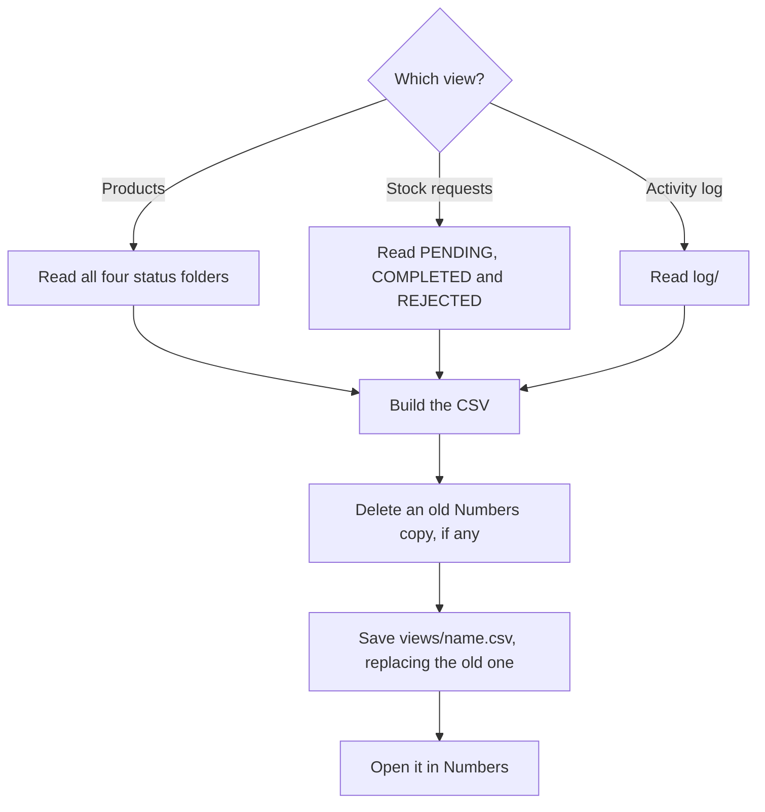

# Periwinkle – Register

**Who runs it:** the operator. **Source:** `register` in
[`build.py`](../../product-ops/build/build.py).

Reads the records and builds one table to read in Numbers. It's how you search and
filter by SKU, status or date, and how you get to a product's Shopify link.

## What happens

## Files

| View | File | Columns |
|---|---|---|
| Products | `views/Product Register.csv` | SKU, CostPrice, SellingPrice, ProductStatus, StockStatus, ShopifyURL, SubmittedAt, PublishedAt, LastStockUpdateAt, OperatorNotes |
| Stock requests | `views/Stock Requests.csv` | SKU, RequestID, RequestedStockStatus, RequestStatus, RequestedAt, ProcessedAt, OperatorNotes |
| Activity log | `views/Activity Log.csv` | SKU, Timestamp, EventType, PreviousValue, NewValue, Source, Notes |

There's one file per view, with the same name each time. Sharing the folder gives
the client the latest tables too.

## Good to know

- **It's a snapshot.** Run Register again to refresh it. Anything typed into the
  table is lost, because nothing flows back to the records.
- **Rows aren't sorted.** Sort or filter in Numbers.
- **The first run may need a second try** to open Numbers. This was seen once in
  testing when Numbers was closed. The file is saved either way, in Files →
  Periwinkle Product Operations → `views`.
- **Speed:** about 2 minutes for 500 records. The Activity log grows the fastest.

## Why it's built this way

- **SKUs are written as `="PBS-0012"`.** Numbers turned a plain `0012` into `12`, even
  in quotes. This form kept the leading zeros in testing.
- **The file is named in the shortcut, not just in the path.** The name's extension
  decides the file type. An earlier version saved a `.json`, and iPhone opened Mail.
- **This is the only shortcut that deletes.** A rebuilt Numbers copy holds nothing the
  records don't, and each is about 140 KB, so keeping them would use up storage.
