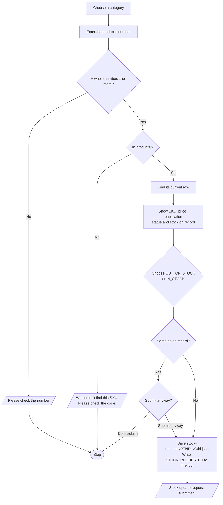

# Periwinkle – Update Stock

**Who runs it:** the client. **Source:** `update_stock` in
[`build.py`](../../product-ops/build/build.py).

Reports that a piece is out of stock or back in stock. It only creates a request
for the operator. It doesn't change Shopify or the product's recorded stock.

## What happens

## Rules

- It never asks for a quantity or photos.
- The client never types `PBS-` or the code, and leading zeros are optional: `4` finds
  `PBS-DUP-004`.
- Each request is a new file named with the time and SKU, so earlier requests are
  never overwritten.
- The recorded stock only changes when the operator completes the request, so
  a second report before then is treated as a real change.

## Good to know

Only products submitted through New Product can be found. Older Shopify products
aren't in the register.
