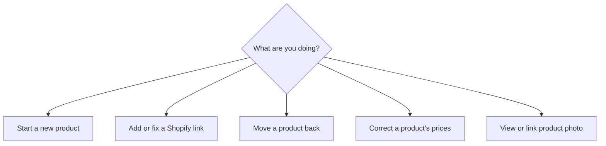
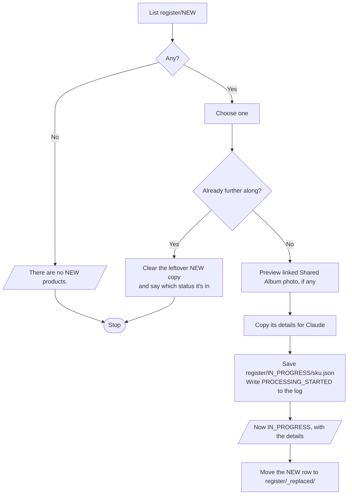
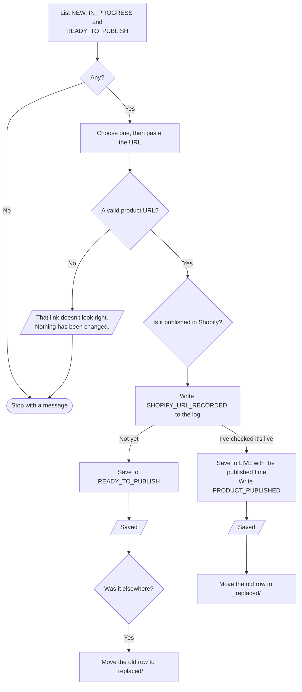
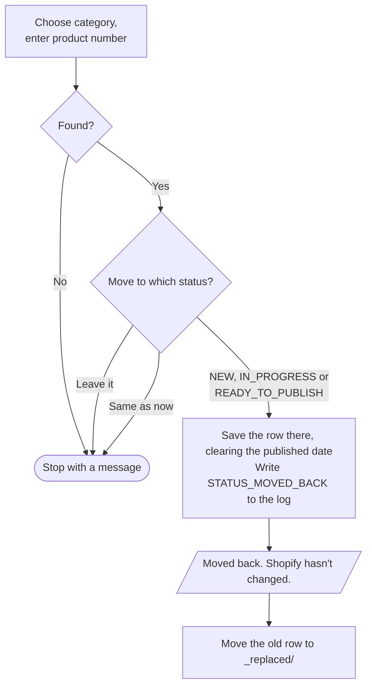
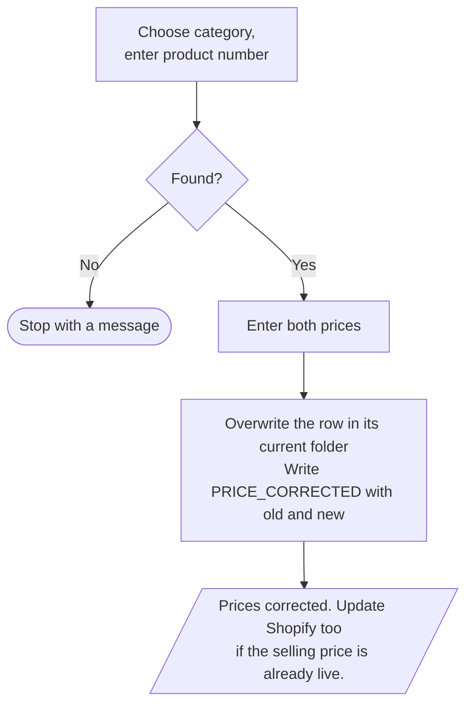

# Periwinkle – Work on Product

**Who runs it:** the operator. **Source:** `work_on_product` in
[`build.py`](../../product-ops/build/build.py).

The operator's main shortcut, covering each change to a single product. The first
menu shows a build number, which confirms which version a phone has.

## Start a new product

From build 13, a linked Shared Album photo previews before the status changes.
For an unlinked piece, use View or link product photo to select it once. Then list the piece with `/add-products list <SKU>` in Claude Code, which
follows the [listing checklist](listing-checklist.md).

## Add or fix a Shopify link

A valid URL starts with `https://periwinklebysherry.com/` or
`https://periwinkle-by-sherry.myshopify.com/` and contains `/products/`. Admin
links are rejected, because the register keeps the public link.

**I've checked it's live** is for products already published, so they don't need a
second step through Publish Products.

## Move a product back

From build 11, this and the next option use the same category menu and number
entry as the client shortcuts. Choose **Dupatta**, then enter **4** to find
`PBS-DUP-004`. Leading zeros are optional, and numbers keep growing beyond 999.
The menu uses the seven current category codes; it does not accept retired codes.

The link is kept. If the product was live, unpublish it in Shopify yourself if it
shouldn't be on sale.

## Correct a product's prices

This works at any status. It doesn't change the original submission in `products/`,
which keeps what the client first sent.

## View or link product photo

Build 13 added this read-only product-photo branch; builds 14–15 fix first-use
and saved-link discovery. New Product build 15 supplies references automatically;
manual linking is for old records and corrections. Choose the category and
number, then View photo or Link or change photo. Linking creates only
`photo-links/<sku>.json`; it does not change product status, prices, stock or
activity entries. Select a photo from the named Shared Album, inspect its
preview, and confirm the link once.

Future views use the stored album, exact photo name (without adding an
extension) and Date Taken. The image remains in the Shared Album. No image
copy is saved, and lookup never falls back to a personal-library copy. See
[Register](register.md#shared-album-photo-links) for matching, removal behaviour
and the remaining phone checks. The same helper runs automatically before
Start a new product's status change when a link already exists.
