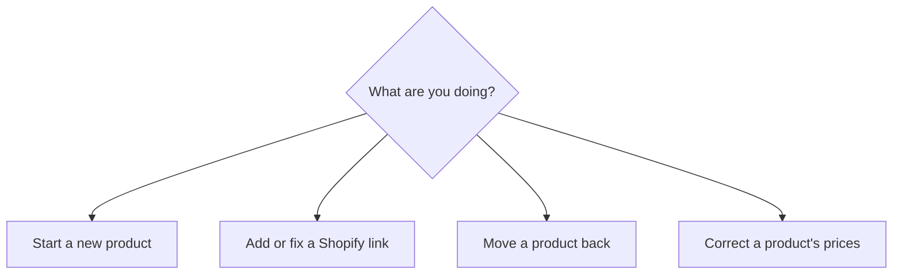
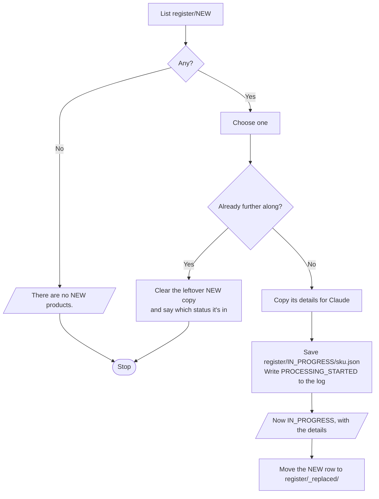
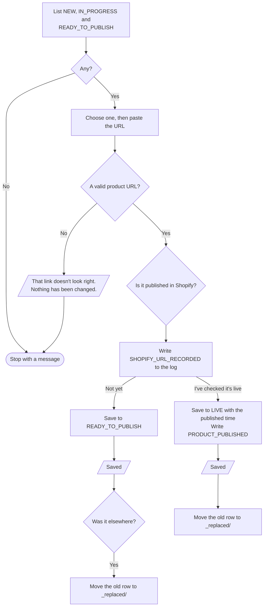
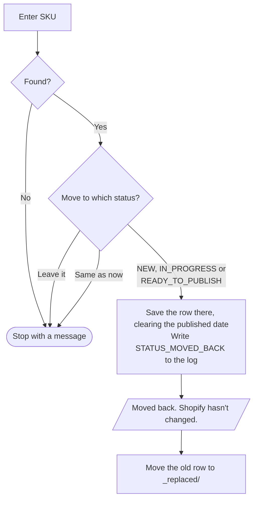
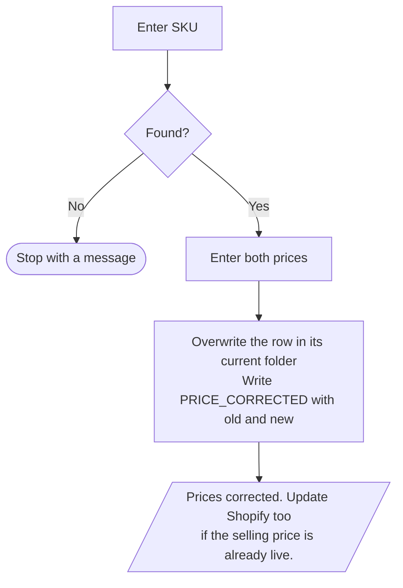

# Periwinkle – Work on Product

**Who runs it:** the operator. **Source:** `work_on_product` in
[`build.py`](../../product-ops/build/build.py).

The operator's main shortcut, covering each change to a single product. The first
menu shows a build number, which confirms which version a phone has.

## Start a new product

Find the photos in the album using the submitted date, because Photos can't
search by SKU. Then list the piece using the
[listing checklist](listing-checklist.md).

## Add or fix a Shopify link

A valid URL starts with `https://periwinklebysherry.com/` or
`https://periwinkle-by-sherry.myshopify.com/` and contains `/products/`. Admin
links are rejected, because the register keeps the public link.

**I've checked it's live** is for products already published, so they don't need a
second step through Publish Products.

## Move a product back

The link is kept. If the product was live, unpublish it in Shopify yourself if it
shouldn't be on sale.

## Correct a product's prices

This works at any status. It doesn't change the original submission in `products/`,
which keeps what the client first sent.
